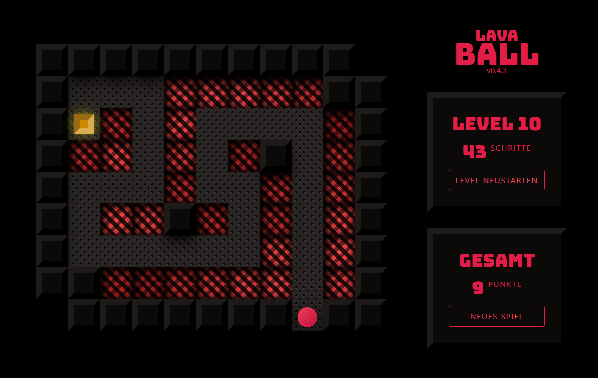

# LAVA BALL

Find the gold. Avoid the heat!

> This is just a little game I made for my kids to practice hands-eye-coordination and directions. Some of the levels the kids draw on a paper and I implemented them accordingly.

## Demo

<https://lavaball.devmount.de/>



## How to play

Use the arrow keys to navigate a little ball to the gold mine. But be warned: there are traps on the way!

## Project setup

```bash
pnpm install
```

### Compiles and hot-reloads for development

```bash
pnpm dev
```

### Compiles and minifies for production

```bash
pnpm build
```
